# JH Task Tracker on Anna

JH Task Tracker on Anna helps you plan your day, move projects forward and log real focus time, with AI that reads your own tasks and history and tells you what matters next. It runs as an app on Anna AI OS and uses your Anna AI model, so there's no API key to set up.

It evolved from [JH Task Tracker](https://github.com/JessamyH/jh-task-tracker), a single-file productivity app built around my own workflow. This version was refactored for Anna: data lives in Anna storage, the AI runs through your Anna model, and new AI features plan your day and week, check on projects and summarise your work.

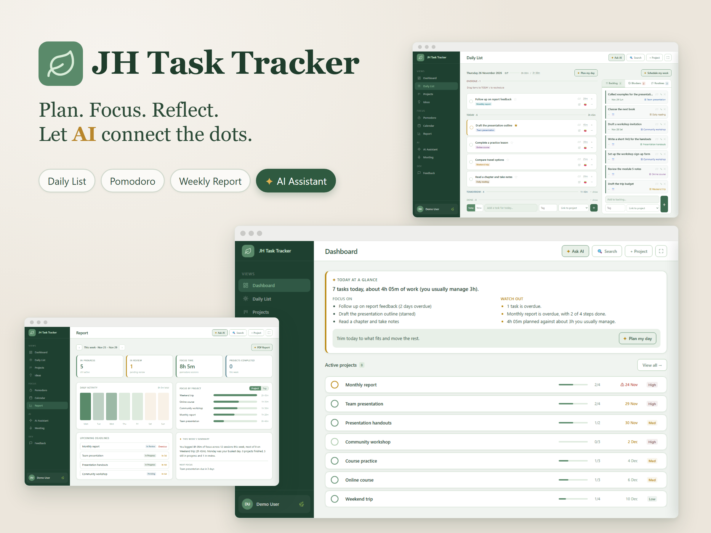

- [Privacy policy](PRIVACY.md)
- [Support / report an issue](https://github.com/JessamyH/jh-task-tracker-anna-docs/issues)

## Features

### Dashboard: Today at a glance

Every morning the AI writes a short briefing from your tasks, deadlines and focus history: the two or three things that matter most today, what could go wrong and one suggested next step with a button that does it. It warns you about overdue tasks, projects falling behind, a day planned beyond what you usually manage and open blockers. Below it, your active projects are listed with the most urgent first, each with its progress.

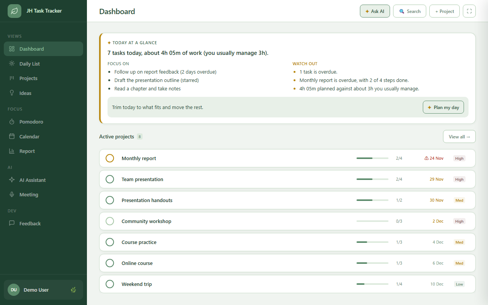

### Daily List

Today, tomorrow, overdue and done tasks in one list, with time estimates and a daily focus goal. A side panel keeps your backlog, blockers and routines. Routines are recurring tasks that add themselves on the days you choose.

- **✦ Plan my day / Plan tomorrow**: the AI puts the day's tasks in order and fits them into your usual working hours.
- **✦ Schedule my week**: places backlog items over the coming week without overloading any day.

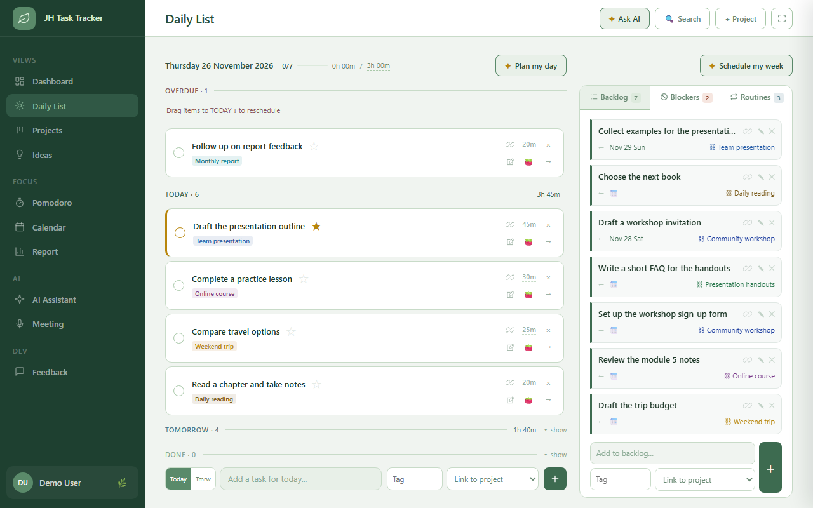

### Projects

See your projects as a board or a list, with status, priority, tags and due dates. Each project has a short Done when checklist of the steps that finish it.

- **✦ Break into tasks**: turns the open steps into daily tasks.
- **✦ Project check**: an honest read on whether the project is on track and what to do next.

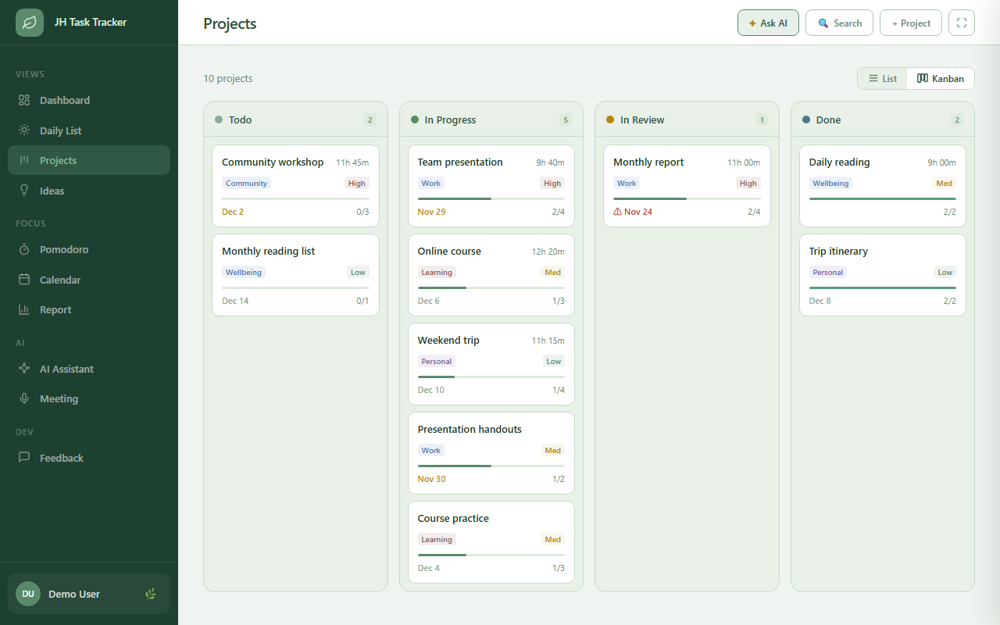

### Ideas

Write ideas down the moment they come, so they don't slip away. Come back to them when you're ready to turn one into a project.

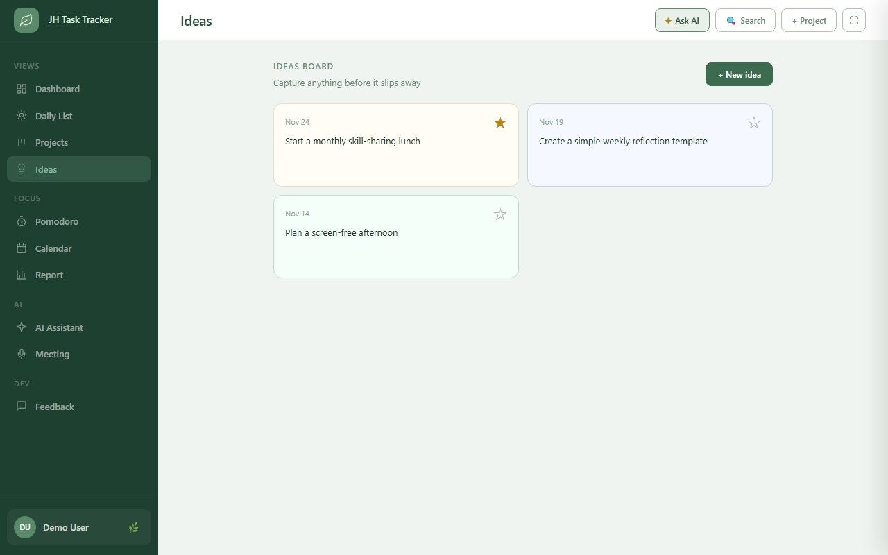

### Pomodoro

Focus and break timers linked to a project and task, with optional background noise. Every session is logged.

- **✦ Timesheet**: the AI turns your session log into a ready-to-send timesheet.

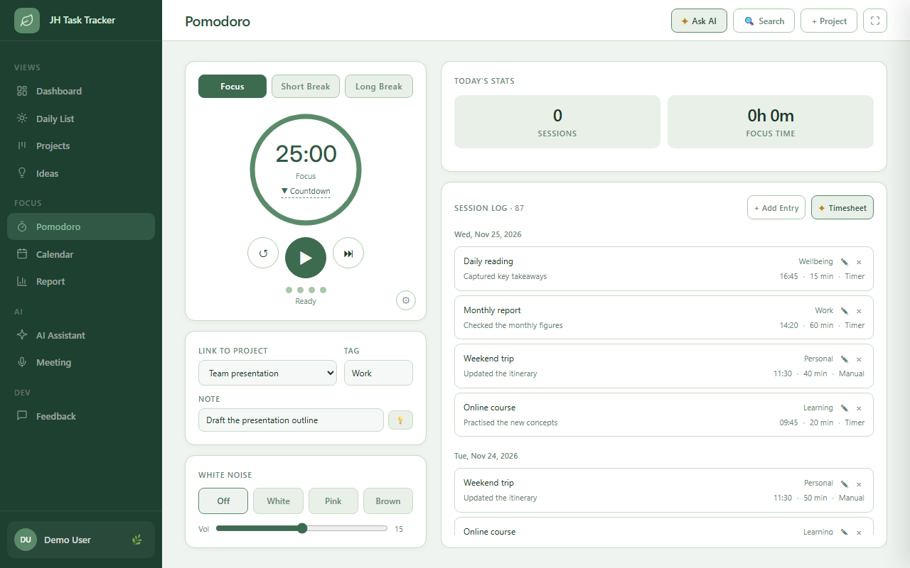

### Calendar

Your week at a glance: planned tasks, routines and logged focus sessions laid out by day and hour. Drag blocks to move them.

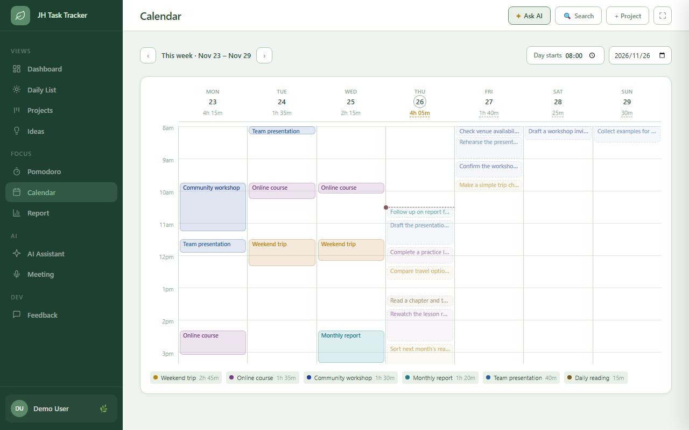

### Weekly Report

Focus time, sessions, daily activity and time per project or tag for any week, plus upcoming deadlines. The AI writes a short summary of the week with highlights and what to carry forward, and ✦ PDF Report saves it all as a PDF.

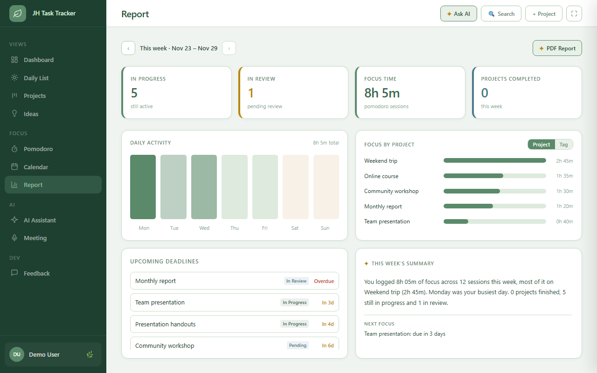

### AI Assistant

Chat about your work with AI that knows your projects, tasks and focus log: wrap up your day, check on projects, work through blockers or polish a message. Two one-click reports:

- **Weekly Standup**: drafts your weekly update from your tasks and focus log: what you did, what's next and what's blocking you.
- **Efficiency Review**: looks at where your focus time went and suggests how to work better next week.

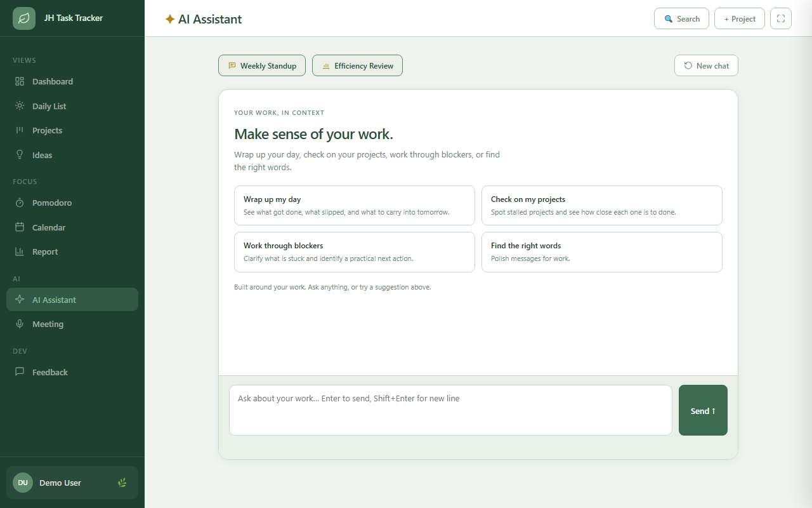

### Meeting Assistant

Keep a checklist of questions, paste what others said or a screenshot of it for the AI to analyse, get help with what you want to say, and take notes as you go.

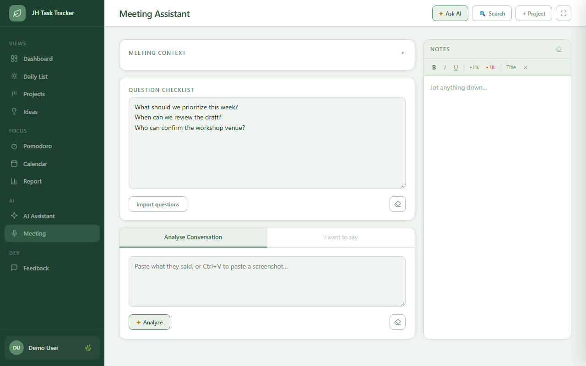

### Feedback

Send a bug report or an idea, and see what changed in each version.

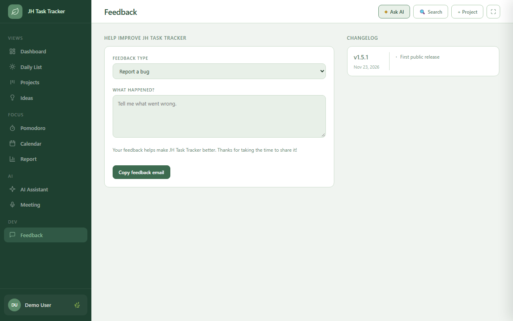

## Your data

Tasks, plans, focus logs and settings are saved in the app's own Anna storage. Display preferences such as the theme stay in the window. See the [privacy policy](PRIVACY.md) for details.
